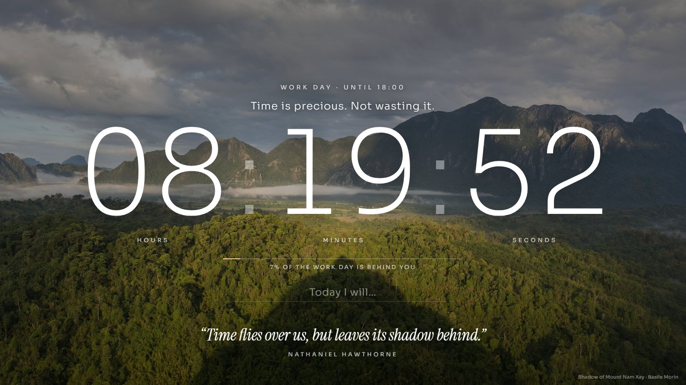
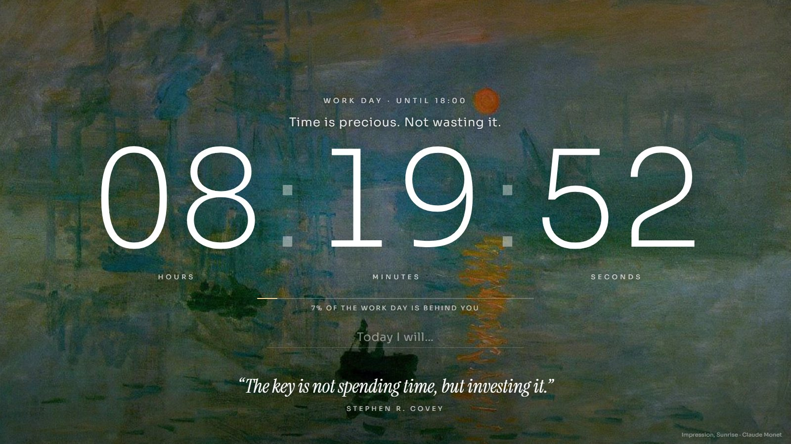
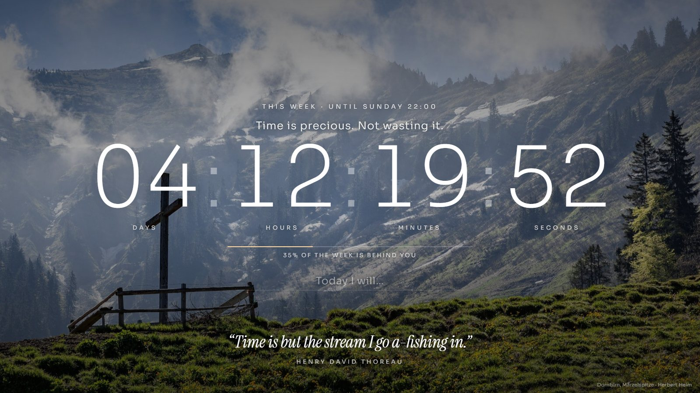
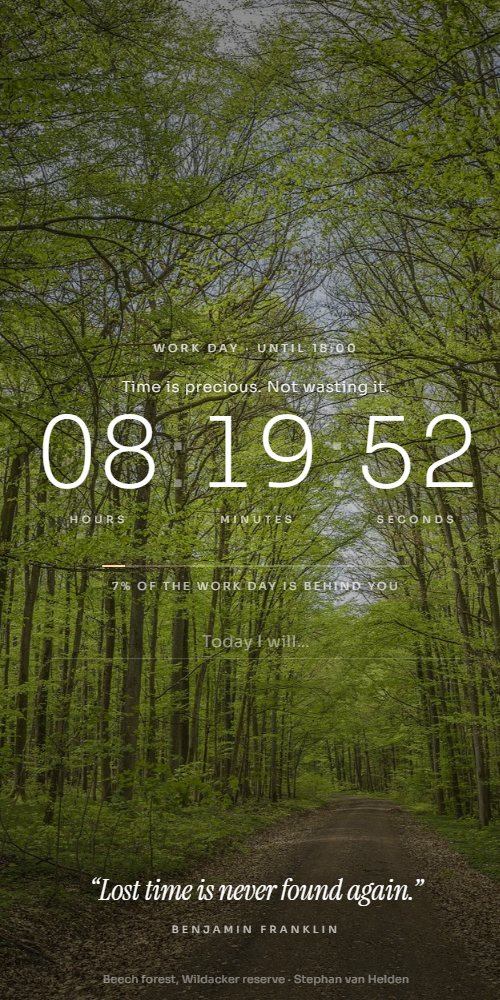
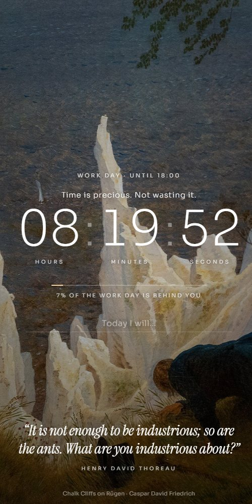

# Time is precious

A full-screen home page that shows how much of your day is left, over a changing background of nature photography and famous paintings, with a stoic quote about time.

**Live page:** https://aloe-andrea.github.io/New-/




## What it does

- **Countdown to the end of your day.** Large, ultra-thin hours, minutes and seconds, with a progress line and the share of the day already behind you.
- **Switches automatically.** On working days it counts down to the end of the work day (09:00 to 18:00). Evenings, weekends, public holidays and your own days off count to 22:00. Between 22:00 and 05:00 it shows a calm "The day is done" screen.
- **Public holidays and days off.** The country is guessed from the device's time zone and the holidays come from the free Nager.Date service, saved on the device for 30 days so it also works offline. Regional holidays and your own days off (single days or ranges) are set in `CONFIG`.
- **Pictures that fit the hour.** Every image is tagged dawn, day, golden hour or night, and the page prefers soft morning light early, bright scenes at midday, golden light towards sunset and night skies in the evening. Sunrise and sunset are estimated from the date alone, so no location permission is needed.
- **Readable at any brightness.** The darkness of the overlay follows each picture's brightness, so pale pictures keep their text readable and dark ones are not dimmed further.
- **Today's intention.** A single line, "Today I will...", saved on the device and cleared at midnight.
- **Day, week or year.** Tap the percentage line to switch the countdown between the rest of the day, the week (to Sunday 22:00) and the year. Open `index.html#view=week` or `#view=year` to start in that view.
- **Changing backgrounds.** 37 bundled images (16 nature photos, 21 paintings by Hokusai, Van Gogh, Monet, Turner, Friedrich and others) crossfade every five minutes. When online it also mixes in fresh featured nature photos from Wikimedia Commons.
- **Quotes about time.** 53 quotes from Seneca, Marcus Aurelius, Epictetus, Franklin, Thoreau and others, rotating with the pictures.
- **Works offline.** Fonts, bundled images and the app shell are cached, so it still opens without a connection.
- **Keyboard and touch.** Press Space or the right arrow, or tap the screen, for the next picture and quote.



## On iPhone

 

- **Home Screen app:** open the live page in Safari, tap Share, then **Add to Home Screen**.
- **Home Screen and Lock Screen widget:** see `widget.html` (an install page) and `time-widget.js`, a script for the free Scriptable app. It follows the same rules for holidays, days off, time-of-day pictures and brightness. Tapping the widget opens the page.

## Settings

Times, country, region, days off, the strength of the picture overlay and the rotation speed are set in the `CONFIG` block at the top of the script in `index.html`. The widget has its own `CONFIG` in `time-widget.js`. Example:

```js
country: "auto",                                   // or "DE", "CH", "IT", "HU" ...
region: "NW",                                      // optional state or canton
daysOff: ["2026-12-24", "2026-12-28..2027-01-01"]  // your own days off, single days or ranges
```

## Files

| Path | Purpose |
|------|---------|
| `index.html` | The page: layout, countdown logic, holidays, quotes, background rotation |
| `images/`, `images.js` | Bundled backgrounds with title, credit, tone and brightness |
| `fonts/` | Sora (numerals) and Instrument Serif italic (quotes), bundled for offline use |
| `manifest.webmanifest`, `sw.js`, `icons/` | iPhone and Android app install and offline caching |
| `time-widget.js`, `widget.html` | Scriptable widget and its install page |
| `docs/screens/` | Screenshots used in this README |

## Credits

Nature photos come from Wikimedia Commons featured pictures and paintings are in the public domain, mostly from Wikimedia Commons. The title and photographer or artist appear in the bottom corner of the page. Public holiday data comes from [Nager.Date](https://date.nager.at).
